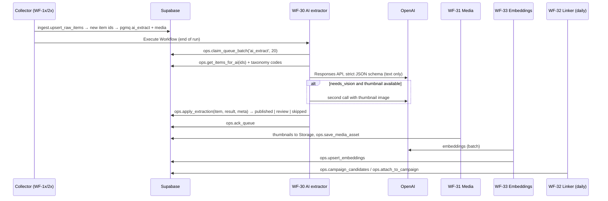

# AI pipeline — everyone. Market Radar

How a new item turns into intelligence. Owner milestones: **M06** (media v1), **M07** (extraction, resolution, media extensions, embeddings), **M08** (campaign linker), **M12** (tuning), **M13** (briefs).
Files: schema `reference/json-schemas/item_extraction.v1.json`, prompts `reference/prompts/*.md`. Copy both to `n8n/prompts/` in M07 and version them.

## 1. Flow

## 2. Models

| Use | Env var | Default proposal (verify current OpenAI models in M07) | Why |
|---|---|---|---|
| Per-item extraction (text, optional image) | `OPENAI_MODEL_EXTRACT` | a fast, low-cost model with Structured Outputs + vision (e.g. `gpt-5-mini` class) | Volume |
| Hard cases, campaign tie-breaks | `OPENAI_MODEL_REASON` | the same fast model at higher reasoning effort, or the stronger model | Rare |
| Weekly briefs | `OPENAI_MODEL_BRIEF` | the stronger general model (e.g. `gpt-5` class) | Quality, 4 calls/week |
| Embeddings | `OPENAI_MODEL_EMBED` | `text-embedding-3-small` (1536 dims) | Matches `vector(1536)`; multilingual |

**Model choice in M07:**
1. Run the eval set (§8) on 2–3 candidate models.
2. Pick the cheapest model that meets the accuracy targets.
3. Record the choice and the eval results in `docs/DECISIONS.md` → Changes.

Store prices in `ops.price_book`.

## 3. Call details

- **API:** OpenAI Responses API (or Chat Completions) with `response_format`/`text.format` set to `json_schema` with `strict: true`. Verify the current parameter names in the OpenAI docs.
- **Temperature:** low or default for extraction, per the model's support. No streaming.
- **Batch:** n8n processes 20 items per execution (`ops.settings.ai_batch_size`) and runs concurrent requests (5 at a time) to respect rate limits.
- **Optional cost lever (M12):** the OpenAI Batch API for backfill items (about 50% cheaper, 24h turnaround). Backfill items aren't time-sensitive, so they can be marked `ai_status = 'pending'` and sent in batch jobs.
- **Retries:** 3 attempts with exponential backoff on 429/5xx. A message with `read_ct > 3` makes the item `ai_status = 'failed'`; it is archived and logged.
- **Validation:** re-validate the JSON with the same schema in a Code node (ajv) before calling `ops.apply_extraction`. Reject invalid output and retry once.
- **Logging:** tokens from `usage`, cost computed from `ops.price_book`, and latency. These go to `ops.ai_extractions` and `ops.cost_ledger` (category `ai_extract`).

## 4. Inputs per item (`ops.get_items_for_ai`)

The input includes:
- **Item text:** title, caption, credits_text, mentions, tagged accounts, hashtags, platform, item type, published date, duration and URL.
- **Competitor:** name, markets and categories.
- **Alias hints:** known aliases matching the item's handles, so the model reuses existing names.
- **Taxonomy codes:** the active codes from `app.taxonomy_terms`.

Captions are truncated to 6,000 characters.

**Website project pages:** pass the page markdown (first 6,000 characters), which usually holds the client and the credits.

**LinkedIn posts:** use the same extraction. LinkedIn posts are often about hiring or company news, so `is_commercial_work = false` is common there.

## 5. Applying results (`ops.apply_extraction`)

1. Insert `ops.ai_extractions`.
2. **Brand / agency resolution** (`private.resolve_org`):
   1. If a handle is present, look for an exact match in `org_aliases.alias_normalized`.
   2. Otherwise compare the normalized name exactly against aliases and `organizations.name`.
   3. Then try a trigram similarity of at least `alias_trgm_min` (0.6) within the same `kind`, and take the top match.
   4. Optionally, in M12, try an embedding similarity of at least `alias_embedding_min` against org embeddings.
   5. If nothing matches, create the organization with `status = 'unconfirmed'`, create a review task `new_brand`/`new_agency`, and set `seen_count = 1`. On the second sighting from a different item, auto-confirm if the extraction's brand confidence is ≥ 0.9.
   6. Always add the seen spelling and handle to `org_aliases` (source `ai`).
3. **People:** the same cascade on `person_aliases`. New people become `unconfirmed`; their review tasks get low priority.
4. **Production house:** `is_posting_competitor` → `production_competitor_id = competitor_id`. Otherwise, try to match `other_name` against the competitors' names and aliases. A match sets that competitor and adds a credit row `production_company`. No match keeps the posting competitor and opens a review task.
5. **Write AI fields** to `app.items`, skipping any field in `locked_fields`.
6. **Status:**
   - `overall ≥ auto_publish_threshold` (0.80) and `is_commercial_work = true` → `published`.
   - `is_commercial_work = false` with confidence ≥ 0.8 → `skipped`. The item stays visible in the "All posts" filter but is not in the commercial feed, campaigns or briefs.
   - Everything else → `review`, plus a review task `item_low_confidence` with the reason (the lowest field confidence).
7. Enqueue `embed` for the item.

**Human locks:** when an analyst corrects a field in the review queue or on an item page, `app.correct_item` adds the field to `locked_fields`. Later runs or re-extractions never change locked fields. Approving a review also teaches aliases (source `human`).

**Attempt identity and replay (29October local M07 clarification):** one extraction attempt has an immutable UUID, item, owner and prepared model/prompt/schema configuration. Repeating application or recovering its original committed receipt is a replay: it creates no extra receipt, cost, sighting, alias, credit, review or embedding message, and never grants another provider dispatch. A deliberate new attempt/version is separately attributable; entity confirmation still counts distinct items, not repeated attempts of one item. Unknown provider usage remains unknown and held for reconciliation. The original phrase “a new extraction row when called again” means a new explicit attempt, not transport replay. The current local slice uses controlled responses and simulated accounting only; hosted queues and actual model behavior remain untested.

## 6. Vision

- **Text first.** The model sees an image only when the first pass says `needs_vision = true` and a thumbnail exists.
- **Image source:** the stored Storage URL (signed if the bucket is private), else the source thumbnail URL.
- **Expected rate:** under 25% of items. Measure it in the pilot.
- **Cost guard:** `ops.settings.vision_max_share` (default 0.3). Above that share, vision is skipped and the item goes to review.

## 7. Embeddings (WF-33)

| Entity | Text embedded (`content_hash` = sha256 of this text) |
|---|---|
| item | title + summary_en + caption_en (or original) + brand + competitor + content_type + occasion + tags |
| campaign | title + summary_en + brand + competitor + agency + occasion + the titles of its items |
| competitor | name + categories + in-house + the summaries of its last 20 campaigns (refreshed weekly) |
| organization | name + industry + aliases (for resolution) |
| brief | title + headline + body |

- **Batching:** up to 100 inputs per embeddings request.
- **Skip unchanged:** skip when `content_hash` hasn't changed (`ops.upsert_embeddings` checks this).
- **Search queries:** the web app and the API embed the user's query at search time with the same model. This is the only OpenAI call outside n8n; it runs server-side.

## 8. Evaluation (M07 and M12)

**Building the eval set:**
- `scripts/eval/build-sample.ts` takes 200 items from the pilot backfill, stratified by platform, country and competitor tier.
- It exports `eval/sample.v1.jsonl` with blank labels.
- Codex pre-fills labels with the strongest model, and the owner or a researcher confirms or corrects them in a simple review sheet (CSV) or in the app's review page once M11 exists.

**Metrics** (`scripts/eval/run.ts` → `eval/results-<model>-<date>.md`):

| Metric | Target |
|---|---|
| brand accuracy (exact org after resolution) | ≥ 90% |
| production-house accuracy | ≥ 95% |
| commercial-flag accuracy | ≥ 95% |
| content_type accuracy | ≥ 85% |
| occasion accuracy | ≥ 85% |
| credits precision | ≥ 90% |
| credits recall | ≥ 70% |
| calibration: accuracy of items with overall ≥ 0.80 | ≥ 93% |
| cost per item | measured |
| p95 latency | measured |

**Threshold tuning (M12):** pick the lowest `auto_publish_threshold` that keeps the accuracy of auto-published items at or above 93%. The owner approves the new value.

## 9. Campaign linker (WF-32, daily 06:30 Cairo)

1. **Candidates** (`ops.campaign_candidates`): for each newly published commercial item not yet in a campaign, find campaigns with:
   - the same `brand_id` and the same `production_competitor_id`;
   - `last_seen_at` within `campaign_window_days` (45) of the item's `published_at`;
   - a ranking by embedding similarity (item vs campaign) and title trigram.
2. **Decision:**
   - Similarity ≥ `campaign_similarity_min` (0.82) → attach.
   - No candidate, or similarity < 0.75 → create a new campaign (title = `campaign_title`, or `"{brand} · {occasion or content_type} · {Mon YYYY}"`).
   - In between, or two candidates within 0.03 → tie-breaker prompt `campaign_link.v1`; if its confidence is < 0.8 → review task `campaign_merge`.
3. **Cross-platform:** the same film posted on Vimeo, Instagram and the website lands in one campaign through the same brand + house + time + similarity. Website pages with `media_urls` pointing at a known Vimeo or YouTube item attach directly.
4. **Updates:** refresh the campaign's `first_seen_at`/`last_seen_at`, `item_count` and `platforms[]`, regenerate `summary_en`/`summary_ar` when items are added (fast model, short prompt), and enqueue `embed`.
5. **Human edits:** campaigns with `locked_by_human = true` never get items removed by the linker; it can only add items.

## 10. Weekly briefs (WF-50)

- **When:** Monday 08:00 Cairo, for the scopes EG, KSA, UAE and ALL.
- **Input:** `ops.get_brief_inputs` → prompt `weekly_brief.v1` → schema `weekly_brief.v1.json`.
- **Save:** `ops.save_brief`, then embed the brief, revalidate tag `brief:{week}`, and email (WF-80, `weekly_brief` rule).
- **Citations:** every claim cites items or campaigns. The app turns `[item:<id>]` into links.

## 11. Safety and quality guards

- The model never sees secrets; prompts contain public data only.
- Captions are data, not instructions. The system message says so, and any text in a caption that tries to instruct the model is ignored. (Prompt-injection hygiene: wrap captions in delimiters and keep the instructions in the system message.)
- Arabic is handled natively. Summaries are produced in both languages.
- A daily sample audit (M12 onward) puts 10 random auto-published items into the review queue with low priority, as `kind = item_low_confidence` with reason `audit_sample`, to keep measuring accuracy.
