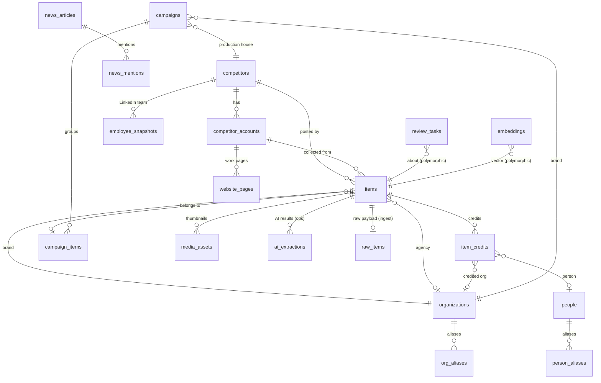

# Data schema — everyone. Market Radar

Database: Supabase Postgres (dev + prod). Draft SQL, in apply order: `reference/sql/001…006`. **The draft is a starting point, not a migration.** In M01 Codex creates real migrations with `supabase migration new <name>`, adapts the SQL, completes every function marked SKETCH in its owning milestone, runs `supabase db advisors` and the pgTAP tests, and generates types with `supabase gen types typescript`.

## 1. Schemas and who can touch them

| Schema | Holds | Exposed to Data API? | Who reads | Who writes |
|---|---|---|---|---|
| `app` | Clean data: competitors, accounts, items, campaigns, organizations, people, news, briefs, review, taxonomies, embeddings, members | Yes (RLS) | Signed-in members (`authenticated` + `private.is_member()`), `api_agent` | Only through RPCs (pipeline RPCs in `ops`/`ingest`, user RPCs in `app` → private workers) |
| `ingest` | `raw_items`: untouched source payloads + normalized form | No | Nobody directly (debug via SQL editor as owner) | `n8n_writer` via `ingest.upsert_raw_items` |
| `ops` | Runs, Apify runs, AI extractions, cost ledger, price book, API keys and calls, audit log, settings, queue RPCs | No | Admin pages through `app.*_summary` RPCs (private workers) | `n8n_writer` via `ops.*` RPCs; API layer for `api_calls` |
| `api` | Security-invoker views + RPCs for agents | No (reached through the Next.js API with the `api_agent` login role) | `api_agent` | `api_agent` via scoped write RPCs |
| `private` | `is_member()`, `has_role()`, triggers, workers (`SECURITY DEFINER`) | No | — | — |

## 2. Entity relationships



## 3. Tables (app)

| Table | Purpose | Key columns / constraints | Notes |
|---|---|---|---|
| `members` | App users | `user_id` → auth.users, `email` unique, `role` viewer/analyst/admin, `status` | Created by trigger on first Google sign-in from `member_invites` |
| `member_invites` | Pre-approved emails | `email` pk (lowercase), `role` | Seed: owner as admin |
| `allowed_domains` | Optional domain auto-join (off by default) | `domain` pk | |
| `competitors` | 284 + baseline | `company_code` unique (C000–C284), `slug` unique, `markets[]`, `categories[]`, `in_house[]`, `priority_tier`, `pilot_rank`, `is_baseline` (one only) | Seed from `data/competitors.csv` |
| `competitor_accounts` | One row per tracked account **and per collection type** | unique `(platform, handle_norm)` (generated `lower(handle)`); watermark columns; `next_due_at`, `locked_until`, `cadence`; `backfill_*` | Instagram gets two rows (`instagram`, `instagram_stories`); LinkedIn gets two (`linkedin`, `linkedin_employees`); websites get `website` (root, for the URL map) and `website_work_page` |
| `organizations` | Brands, agencies, post houses, media | `kind`, `slug` unique, `industry` (brands), `status` confirmed/unconfirmed/merged, `merged_into` | Created by the AI resolver or humans |
| `org_aliases` | Every spelling/handle | unique `(alias_normalized, org_id)`, trigram index | Taught by approvals |
| `people` | Credited professionals | `slug` unique, `primary_role`, `linkedin_public_id` unique | No contact data |
| `person_aliases` | Name variants (EN/AR) | trigram index | |
| `items` | Every collected piece | unique `(platform, external_id)`; `published_at`; source text; `metrics` jsonb (latest); `status` active/removed; `content_hash`, `duplicate_of`; AI fields; `locked_fields[]`; `search_tsv` | Keyset index `(competitor_id, published_at desc, id desc)`; partial feed index |
| `item_credits` | Credits per item | unique `(item_id, person_name_raw, role)`; `person_id`, `organization_id`, `competitor_id` | From AI (captions, Vimeo descriptions, website credits) or humans |
| `media_assets` | Stored thumbnails/key frames/logos | `storage_path` unique | Bucket `media` |
| `campaigns` | Grouped work | `brand_id`, `production_competitor_id`, `agency_id`, `first_seen_at`, `last_seen_at`, `platforms[]`, `locked_by_human` | Linker rule D-16 |
| `campaign_items` | Item ↔ campaign | `item_id` unique (one campaign per item) | |
| `website_pages` | Known URLs per work page | `url` unique, `status` new/crawled/ignored/removed/failed | Daily diff target |
| `employee_snapshots` | Weekly LinkedIn team snapshot | unique `(competitor_id, snapshot_date)`; `people`, `joined`, `left_company` jsonb | Growth/hiring signal (D-08: jobs out of scope) |
| `news_articles` / `news_mentions` | Weekly SerpAPI news and awards | `url` unique; polymorphic mentions | |
| `briefs` | Weekly AI briefs | unique `(week_start, scope)`; `highlights` with item citations | |
| `review_tasks` | Human queue | `kind`, polymorphic `entity_type/entity_id`, `suggestion`, `status`, `priority` | Partial index on open |
| `taxonomy_terms` | Editable lists | unique `(taxonomy, code)` | `docs/TAXONOMIES.md` |
| `alert_rules` | Email rules | `kind`, `filters`, `recipients[]` | Seeded in **M13**: daily digest + instant launch + budget + failing sources + weekly brief → owner |
| `saved_views` | Per-user saved filters | owner-only RLS | |
| `embeddings` | Vectors | unique `(entity_type, entity_id)`; `content_hash` to skip unchanged; HNSW cosine | 1536 dims |
| `stats_daily` | Dashboard aggregates | pk `(day, competitor_id, platform)` | Refreshed daily |

## 4. Tables (ingest, ops)

| Table | Purpose |
|---|---|
| `ingest.raw_items` | Raw payload + normalized JSON per `(platform, external_id)`; insert-only |
| `ops.scrape_runs`, `ops.scrape_run_accounts` | Run log per workflow run and per account |
| `ops.apify_runs` | Async Apify run tracking (run ID ↔ scrape run ↔ accounts, dataset, usage USD) |
| `ops.ai_extractions` | Every AI call: model, prompt/schema version, tokens, cost, output, confidence, vision flag |
| `ops.price_book` | Unit prices per provider/SKU (dated) |
| `ops.cost_ledger` | Every paid unit, by day/provider/category/platform/competitor/item/run |
| `ops.api_keys`, `ops.api_calls` | Agent keys (hashed, scoped) and call log |
| `ops.audit_log` | Human, API and system changes (before/after) |
| `ops.settings` | Tunables: `auto_publish_threshold` 0.80, `campaign_window_days` 45, `campaign_similarity_min` 0.82, `alias_trgm_min` 0.6, `alias_embedding_min` 0.85, `daily_budget_usd` (150 during backfill, ~25 steady), `metrics_refresh_days` 30, `removal_window_days` 90, `stories_twice_daily`, `ai_batch_size` |
| `ops.worker_gateway_rate_windows` | GW-01 private dev singleton: immutable reviewed deployment binding, prepared/open/closed window,30-minute expiry and persisted admission counters |
| `ops.worker_gateway_requests` | GW-01 request ID, operation, database-computed JSONB digest, reservation and bounded terminal result/error; no raw args or credentials |
| `ops.worker_gateway_leases` | GW-01 two business-operation slots, linked only to the private request ledger |
| pgmq queues | `ai_extract`, `embed`, `media` |

## 5. RPC catalog

### Pipeline (EXECUTE: `n8n_writer`)
| Function | Milestone | Does |
|---|---|---|
| `ops.start_run(workflow, platform, mode, env, execution_id) → uuid` | M01 | Opens a run |
| `ops.finish_run(run_id, status, error) → jsonb` | M01 | Closes it with totals and cost, returning the n8n summary |
| `ops.get_due_accounts(platform, limit, run_id, mode) → rows` | M01 | Claims due accounts (`SKIP LOCKED`) |
| `ops.report_account_result(run_id, account_id, status, seen, new, error, backfill_done, cursor)` | M01 (p_secondary planned in M04; not yet applied) | Per-account result, cadence-minus-four-hours schedule, six-hour failure retry |
| `ops.set_account_external_id(account_id uuid, external_id text, uploads_playlist_id text default null) → void` | M04 first slice (local only) | Resolve only a live claimed account under a running dev Vimeo parent and active competitor. Writer-only; preserves scheduling, lease, watermarks and human fields. Null external ID records a fixed resolution failure without erasing saved identifiers. Not yet applied to hosted dev/prod. |
| `ingest.upsert_raw_items(run_id, account_id, items jsonb) → jsonb` | M01 | Single writer path (§5.3 TECHNICAL) |
| `ops.register_apify_run / ops.complete_apify_run` | M03 | Async Apify tracking |
| `ops.process_apify_run(apify_run_id, status, dataset_id, usage_usd, groups) → jsonb` | M03 | Atomic development-only one-page website callback; persisted `ops.apify_runs.processing_result` receipt, replay-safe ingest/report/cost/complete/finish. Existing M01 signatures unchanged; other branches remain gated. |
| `ops.log_cost(entries jsonb)` | M03 | Cost ledger rows |
| `ops.daily_health() → jsonb`, `ops.accrue_fixed_costs(day)` | M03 | WF-91 |
| `ops.worker_gateway_admit(window_id uuid, request_id uuid, operation text, args jsonb, mode text default 'admit') → jsonb` | M03 GW-01 | Restricted dev admission; durable100-call/30-minute,30/minute,500/day counters, request digest/replay checks and two leases. Private control modes bind/inspect/close are not HTTP aliases. |
| `ops.worker_gateway_execute(window_id uuid, request_id uuid, operation text, args jsonb) → jsonb` | M03 GW-01 | Closed connection-trial CASE; operation and result commit atomically. Parent→request→lease locks coordinate closure, duplicates and expiry. |
| `ops.worker_gateway_status(window_id uuid, target_request_id uuid) → jsonb` | M03 GW-01 | Read-only original-request reconciliation, after separately counted fresh status correlation; never reserves or executes the target. |
| `ops.claim_queue_batch(queue, n, vt) / ops.ack_queue(queue, ids)` | M01 | Allowlisted pgmq wrappers |
| `ops.diff_website_urls(account_id, urls[]) → uncrawled urls[]` | M01 | Discover URLs and retain retries until crawled; preserve ignored/removed pages |
| `ops.mark_website_page(...)` | M05 | Website crawl result writer |
| `ops.save_employee_snapshot(account_id, date, people)` | M05 | LinkedIn employees |
| `ops.mark_removed(account_id, seen_ids[], p_since date)`, `ops.mark_website_removals(...)`, `ops.get_removal_targets(...)` | M06 | Removal check + weekly metrics refresh for paid sources |
| `ops.save_media_asset(...)`, `ops.get_media_targets(ids)` | M06 | Media v1 (WF-31) |
| `ops.save_bakeoff_rows(...)` + table `ops.bakeoff_results`, `ops.set_stories_cadence(...)` | M06 | Stories bake-off |
| `ops.get_items_for_ai(ids[]) → jsonb` | M01 | AI input, including normalized credits text and media URLs |
| `ops.apply_extraction(item_id, result, meta) → jsonb` | M07 | AI output writer |
| `ops.upsert_embeddings(rows)`, `ops.enqueue_competitor_embeddings()`, `private.resolve_org`, `private.resolve_person`, `private.norm_alias`, optional `ops.register_ai_batch` + `ops.ai_batches` (Batch API) | M07 | Vectors, entity resolution |
| `ops.campaign_candidates(ids[]) → jsonb`, `ops.attach_to_campaign(...)` | M08 | Linker |
| `ops.upsert_news(articles)`, `ops.save_brief(...)`, `ops.get_brief_inputs(...)`, `ops.get_alert_payload(...)`, `ops.match_instant_rules(...)`, `ops.log_alert_sent(...)` + table `ops.alert_log` (unique `dedupe_key`) | M13 | News, briefs, alerts |
| `ops.create_audit_sample()`, `ops.audit_accuracy()` | M12 | Accuracy audit |
| `ops.activate_wave(...)`, `ops.backfill_progress()`, column `app.competitors.activation_wave` | M15 | Scale-up waves |
| `ops.refresh_stats_daily(from)` | M10 | Dashboards (`app.stats_daily` primary key gains `country`) |
| `ops.campaign_candidates_since(ts)`, `ops.get_campaigns_needing_summary()`, `ops.save_campaign_summary(...)`, `ops.link_by_media_urls()`, `ops.last_successful_run_at(workflow)`, `ops.create_review_task(...)` | M08 | Linker helpers |
| `ops.should_publish(...)` + table `ops.publish_log` | M09 | WF-70 revalidate debounce |
| `ops.query_embeddings(...)` | M11 | Search query embedding cache |

Additional small helper RPCs used by n8n (settings, price book, error log, taxonomy snapshot, media/embedding targets, news queries, brief inputs, alert payloads, onboarding) are listed per milestone in `docs/N8N_WORKFLOWS.md` §8; they follow the same rules.

M03 callback correction: never set `processed_at` in an earlier workflow node.
The one-page website processor locks the parent and registry row, validates the
registered account/actor/environment, persists all effects and a stable result
in one transaction, then completes/finishes. Replays return the saved counts
without another queue send or cost; conflicting inputs fail closed. The SQL
caller is the restricted trusted writer, and actual authenticated Apify HTTP
verification remains a separate workflow responsibility. Current implementation
and local/hosted/type/advisor acceptance are recorded in M03 progress; this
contract alone is not deployment proof.

### GW-01 private dev admission boundary

The owner approved one additive migration,
`20261018070042_n8n_worker_gateway_admission.sql`, for the dev-only strict-TLS
gateway. The nine existing migrations remain unchanged. At this local
checkpoint,102 rollback-only SQL assertions,19 process/transaction checks,
8 safety regressions, both advisors and regenerated `app,api,ops,ingest` types
pass. The session-authorization fixture is not an actual restricted-login or
hosted-trial receipt. See
[local DB evidence](../milestones/M03-n8n-foundation/evidence/local-gw01-db-20261018.json)
and the [approved packet](../milestones/M03-n8n-foundation/evidence/strict-tls-connection-proposal-20261018.md).

All three tables enforce RLS with no writer/browser/agent direct privileges.
Only `n8n_writer` can execute the three new hardened wrappers; implementation
helpers are owner-only. The wrapper checks the session principal and role
setting. Actual `current_user`/`session_user` are verified on the restricted
connection before entering a definer, whose own `current_user` is its owner.
No new internal schema is exposed to the Data API.

One immutable namespace `gw01-dev` and window
`76c2ad42-c094-4ba4-9a0b-566e19b97780` bind exactly one reviewed Preview origin,
commit SHA and deployment ID. `bind` is prepared-only/idempotent for the same
values; it cannot overwrite or reopen. `inspect` is read-only and starts no
clock. First ordinary admission starts30 minutes once. Closing obtains the
parent lock after prior execution commits and remains possible at the100-call
limit without incrementing101. There is no reset/replenishment/TTL deletion.

Responses have `{state,code,result,window}`. Window metadata includes its ID,
timestamps, closed flag, total admitted and the nullable bound audience/commit/
deployment. Timestamps may include an explicit UTC offset. Admission counts
duplicates, conflicts, denied trial operations and separately correlated
status reads; authentication/input denials before SQL are counted by the
bounded coordinator's100-total-network-attempt limit. The SQL counter is not
an anonymous-request billing ceiling or a global database connection cap.

Only `identity.read`, `request.status`, `settings.read`, `prices.read`,
`health.read`, fixed `error.log` acknowledgment and nonclaiming `error.count`
are enabled for this trial. The safe audit workflow identifier is
`M03-GATEWAY-ACCEPTANCE-DEV`. The other known actor/run/cost/fixed-fee aliases
fail closed; arbitrary SQL/RPC/schema/host and raw-ingest bypasses do not exist.
No actor/content/C999/fake-cost operation is authorized by the gateway trial.

Admission must commit separately before execution. A changed operation/args
under the same business ID conflicts with the database-computed digest. The
execution transaction holds parent-window SHARE, request and lease locks,
refreshes the clock after waiting, then checks expiry before the operation and
receipt writes. A canceled/lost response remains unknown until durable status
is read; expired reservations cannot silently execute again. The original
atomic `process_apify_run` contract remains authoritative when a later,
separately approved actor batch is implemented. This connection layer does not
establish callback, actor, exactly-once external delivery or native Postgres
acceptance. Hosted gateway migration/binding/login/trial evidence remains
separate and pending at this checkpoint.

### App users (EXECUTE: `authenticated`; role checked inside)
`app.me`, `app.touch_last_seen`, `app.search`, `app.similar`, `app.compare_competitors` (M10), `app.market_dashboard` (M10), `app.pipeline_summary` (M09), `app.review_reopen`, `app.merge_campaigns`, `app.edit_*`, `app.get_settings`, `app.price_book`, `app.admin_update_price`, `app.admin_list_api_keys`, `app.admin_api_calls`, `app.pipeline_run_detail`, `app.alert_subscribe` / `app.alert_self_subscribe`, `app.admin_activate_wave` (M15), `app.review_resolve`, `app.correct_item`, `app.merge_organizations`, `app.merge_people`, `app.split_campaign`, `app.admin_upsert_competitor`, `app.admin_set_account_status`, `app.admin_request_rescrape`, `app.admin_invite_member`, `app.admin_set_member`, `app.admin_store_api_key`, `app.admin_revoke_api_key`, `app.admin_upsert_taxonomy_term`, `app.admin_upsert_alert_rule`, `app.admin_set_setting`, `app.costs_summary`, `app.pipeline_summary`.

### Agents (EXECUTE: `api_agent`; scope checked inside)
Read: views `api.items_v` (over `app.feed_v`), `api.competitors_v`, `api.campaigns_v` (over `app.campaigns_v`, which the web app also uses), `api.organizations_v`, `api.people_v`, `api.briefs_v`, `api.news_v`; functions `app.search`, `app.similar`, `api.market_stats`.
Write: `api.add_competitor` (write), `api.resolve_review` (write), `api.request_rescrape` (admin).

### M04 fixed collector product contracts (27 October; pending hosted dev)

`20261027092832_m04_collector_product_contracts.sql` adds six private `ops`
tables: `collector_runs`, `collector_accounts`, `collector_launches`,
`collector_passes`, `collector_pages` and `collector_requests`. All have RLS;
machine roles receive no direct table grants. The writer-only
`ops.collector_execute(uuid,text,jsonb)` accepts a closed operation catalog,
hashes immutable request arguments and commits each receipt with its effects.
The private completion function is not executable by the writer. Both definer
functions have empty `search_path`; PUBLIC/anon/authenticated/api_agent cannot
execute them.

The contract reuses existing ingest, account-report, cost and parent-run RPCs.
An exact selected-account claim creates primary or posts+reels pass state.
Registration cannot close with an unregistered required pass, and completion
cannot report/unlock until all passes and registration are complete. Reels
ingestion restores the primary watermark; only final joint reporting schedules
the account. Source evidence is retained across pages independently of filtered
item count, so matched old public content may correctly yield zero items.

Actor launch intent reserves approved aggregate starts/USD across parents.
Registration binds the returned provider ID to its actor/pass/account set.
Private page staging hashes each offset and atomically ingests/cursors without
early reporting or cost. Settlement uses the trusted server's stable provider
facts, apportions actual USD with an exact rounding remainder and stores the
completed receipt. Completed replay cannot duplicate items/cost or release a
newer account owner's claim. The HTTP surface exposes neither raw staging nor
settlement nor arbitrary SQL/RPC; live policy and selected UUIDs are server-bound.

This replaces the draft M04 secondary-selector/signature-extension plan; the
existing eight-argument account report is unchanged. Local qualification and
generated member coverage are in current M04 PROGRESS. Existing local14 versus
hosted/committed15 baseline migration drift is preserved explicitly; the two
new M04 migrations are not yet applied to hosted dev.

## 6. Seed data

| File | Rows | Loads into |
|---|---|---|
| `data/competitors.csv` | 285 (284 + Everyone Films baseline `C000`) | `app.competitors` (`priority_tier`: "A · Pilot"→pilot, "B · Next wave"→next_wave, "C · Adjacent"→adjacent, "Baseline"→baseline; `markets` split on `|`; `hq_country` = first market, owner can correct) |
| `data/competitor_accounts.csv` | 1,272 links (website 261, instagram 256, linkedin 226, vimeo 202, work page 199, youtube 128) | `app.competitor_accounts`. Each `instagram` row also creates an `instagram_stories` row; each `linkedin` row also creates `linkedin_employees` (cadence 7 days). During the pilot only accounts with `pilot=true` are `active`; the rest are `paused`. |
| `data/pilot_50.csv` | 50 | Reference list for the pilot (ranks 1–50) |
| `reference/sql/006_seed_taxonomies_settings.sql` | 120 terms + settings + price book | taxonomies, `ops.settings`, `ops.price_book`, owner invite |

Seeding runs through `scripts/seed-competitors.ts` (M02) using the **secret key or DB owner connection from the owner's machine/CI only**, never from n8n or the web app. It is idempotent on `company_code` and `(platform, handle_norm)`.

## 7. Normalized item contract (collector → DB)

All collectors convert source objects to this shape before calling `ingest.upsert_raw_items`. JSON Schema: `reference/n8n/normalized_item.schema.json`.

```json
{
  "platform": "instagram",
  "external_id": "C9x...shortCode",
  "actor": "apify/instagram-scraper",
  "item_type": "reel",
  "url": "https://www.instagram.com/reel/C9x.../",
  "published_at": "2026-10-16T18:22:00Z",
  "title": null,
  "caption": "...original text...",
  "hashtags": ["ramadan"],
  "mentions": ["vodafoneegypt"],
  "tagged_accounts": ["director.name"],
  "duration_seconds": 45,
  "thumbnail_url": "https://...",
  "metrics": {"likes": 1200, "comments": 40, "views": 56000},
  "payload": { "...": "untouched source object" }
}
```

## 8. Rules Codex must keep

M01 implementation notes: `competitor_accounts.handle_norm` is generated from lowercase `handle` and is the named unique upsert target. The audit links `competitor_accounts.last_run_id`, `raw_items.run_id` and `items.last_extraction_id` have indexed foreign keys. The migration files under `supabase/migrations/` are executable history; `reference/sql/` remains the original draft. Local `seed.sql` contains only fake C999 data and never runs during hosted `db push`.

1. RLS on every table; a pgTAP test per table proves non-members get zero rows and members get rows.
2. Every FK has an index; every list query has a supporting index (check with `EXPLAIN`).
3. No direct table writes from the web app or n8n; RPCs only.
4. Never delete items; mark `removed`.
5. Human-corrected fields (`locked_fields`, `locked_by_human`) are never overwritten by AI.
6. Migrations are additive and reversible where practical; destructive changes need an owner-approved entry in `docs/DECISIONS.md`.
7. Regenerate `packages/shared/src/db.types.ts` after every migration and commit it.
