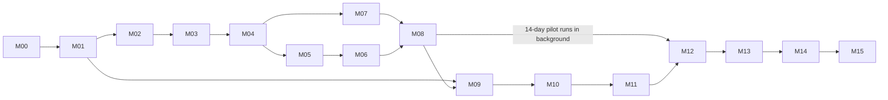

# Development plan — everyone. Market Radar

End-to-end plan from an empty repo to production. Codex works **one milestone at a time, in order**. Each milestone folder (`milestones/Mxx-*/`) holds everything Codex needs for that milestone:
- `MILESTONE.md`: context, scope, tasks, acceptance criteria, the owner's manual actions, and hand-off.
- `PROGRESS.md`: Codex's live notes, covering status, what's done, blockers, manual actions requested, and the next step.

The board at the repo root (`PROGRESS.md`) shows where the project stands.

## 1. Milestones

| ID | Milestone | Goal (one line) | Depends on | Gate to close |
|---|---|---|---|---|
| **M00** | Repo bootstrap & tooling | Monorepo, CI, lint/type/test, env templates, docs pack in repo | — | CI green on `main`; owner can run `pnpm dev` |
| **M01** | Supabase foundation | Dev + prod projects, schemas, roles, tables, RLS, core RPCs, queues, storage, pgTAP | M00 | `supabase test db` green; advisors clean; owner set role passwords |
| **M02** | Seed data & account resolution | 284 competitors + baseline + 1,272 accounts loaded; Vimeo/YouTube/LinkedIn IDs resolved; pilot accounts active | M01 | Counts match CSV; ≥ 95% pilot accounts resolved |
| **M03** | n8n foundation | Credentials, SUB workflows, WF-00 orchestrator, WF-19 Apify callback, WF-90 errors, WF-91 health & cost, run/cost logging | M02 | A dry-run orchestrator run logs a run + cost row; error path emails the owner |
| **M04** | Collectors I: Vimeo + Instagram | WF-10 Vimeo (API + fallback), WF-11 IG posts/reels; backfill from 2024-01-01 for pilot | M03 | 5-account test, then pilot backfill done with < 2% failed accounts; no duplicates |
| **M05** | Collectors II: Websites, YouTube, LinkedIn | WF-21 website diff + crawl, WF-13 YouTube, WF-18 LinkedIn posts, WF-18b employees snapshot | M04 | Same as M04 for these sources |
| **M06** | Collectors III: Stories + upkeep | WF-12 stories (no login) + 7-day actor bake-off, WF-31 media v1 (thumbnails before CDN URLs expire), WF-40 removal check + weekly metrics refresh for paid sources | M05 | Stories captured for ≥ 90% of pilot accounts that posted; removal check marks test removals |
| **M07** | AI understanding | WF-30 extractor (structured outputs), entity resolution, review routing, WF-31 media extensions (vision reads, key frames), WF-33 embeddings, eval set + model choice | M04 (M05/M06 data helpful) | Eval: brand ≥ 90%, production house ≥ 95% on 200 labeled items; cost per item known |
| **M08** | Campaign linker + pilot launch | WF-32 linker, review of merges, daily schedule switched on for the 50 → **14-day pilot clock starts** | M07 | 3 clean daily runs in a row; pilot start date recorded |
| **M09** | Web app foundation | Next.js app, design system from DESIGN.md, Google auth (invite-only), app shell, market pulse, live feed | M01 (+ pilot data from M08) | Owner signs in; feed shows pilot items; Lighthouse ≥ 90 perf/a11y |
| **M10** | Web app entities | Competitors list/profile, campaigns, brands, agencies, people, compare, markets dashboards, stats_daily | M09 | All entity pages render real data; keyset pagination; e2e tests pass |
| **M11** | Search, review, admin | Hybrid search + ⌘K, find-similar, review queue, admin (competitors+onboarding trigger, taxonomies, pipeline, costs, users, API keys, settings) | M10 | Owner completes review + admin flows end to end |
| **M12** | Pilot review & tuning (gate) | Accuracy audit, cost report + forecast, threshold/prompt tuning, actor bake-off decisions, go/no-go | M08 + 14 days, M11 | **Owner go/no-go** recorded in DECISIONS.md |
| **M13** | News, briefs, alerts | WF-22 news + WF-23 awards (SerpAPI), WF-50 weekly briefs, WF-80 alerts, WF-70 publish/revalidate; /news, /briefs, alerts settings | M12 | First Monday brief generated and emailed; digest arrives 09:00 Cairo |
| **M14** | Agent API + MCP | REST /api/v1 + MCP /api/mcp with scoped keys, rate limits, logging, API docs page | M11 | Claude/Codex connect via MCP and run every tool; contract tests pass |
| **M15** | Scale & launch | All 284 active in waves, WF-60 onboarding flow, prod hardening (backups, monitoring, budget alerts, security review), prod launch, user onboarding | M12, M13, M14 | Prod live; 7 clean daily runs at full scale; owner sign-off |

## 2. Order and parallelism

Codex is sequential, but **the pilot runs by itself** once M08 is done. Codex builds the web app (M09–M11) during the 14 pilot days, against live pilot data. M12 starts only when both are true: the pilot has 14 days of data, and M11 is done.

## 3. How Codex works a milestone (the loop)

1. Read `AGENTS.md` → root `PROGRESS.md` → the current milestone's `MILESTONE.md` and `PROGRESS.md`.
2. If `PROGRESS.md` says **Blocked**, check whether the blocker is resolved (the owner may have ticked a manual action). If it is still blocked, do any unblocked tasks; otherwise stop and report.
3. Set the status to **In progress**. Work the tasks in order. After each task:
   - commit;
   - tick the box in `PROGRESS.md`;
   - add a dated log line (what changed, files, test result).
4. When a manual action is needed, add it to `PROGRESS.md` → "Manual actions needed" with exact steps. Set the status to **Blocked: waiting on owner** if nothing else can proceed.
5. When every acceptance criterion passes:
   - set the status to **Done**;
   - fill in "Hand-off to next milestone";
   - update the root `PROGRESS.md` board;
   - open a PR `m{NN}-{slug}` → `main`.
6. Never start the next milestone while the current one isn't Done, unless the root board marks it **Parallel-OK** (only M09–M11 while M12 waits for pilot days).

## 4. Status values

`Not started` · `In progress` · `Blocked: <reason>` · `In review` (PR open, waiting on owner) · `Done` · `Parallel-OK`

## 5. Owner touchpoints (summary)

Full list with steps: `docs/MANUAL_ACTIONS.md`.

| When | What the owner does |
|---|---|
| M00 | Grant Codex push access to the GitHub repo; create the Vercel project; confirm the domain (optional) |
| M01 | Create Supabase dev + prod projects (Pro); create a scoped access token; set the `n8n_writer` / `api_agent` passwords; enable the Google provider (Google Cloud OAuth client) |
| M02 | Create a Vimeo developer app + token; create a Google Cloud API key for the YouTube Data API |
| M03 | Add credentials in n8n (Postgres, Apify, OpenAI, SerpAPI, Firecrawl, Vimeo, YouTube, email); confirm Apify plan tier; set the daily budget |
| M04–M06 | Approve the backfill budget estimate before each pilot backfill |
| M07 | Label or approve the 200-item eval set (Codex drafts it); approve the model choice |
| M08 | Approve the pilot start |
| M09 | Add allowed redirect URLs in Supabase + Google; invite first users |
| M12 | Go/no-go decision; approve tuned threshold and actor choices |
| M13 | Choose the email provider (Resend/SMTP) and verify the sending domain |
| M14 | Create first API keys; connect Claude/Codex MCP |
| M15 | Approve the scale-up waves; final security sign-off; onboard users |

## 6. Rough effort (Codex working time, excluding waiting on the owner)

| Phase | Milestones | Estimate |
|---|---|---|
| Foundations | M00–M03 | 4–6 days |
| Collection + AI | M04–M08 | 8–12 days |
| Pilot (calendar) | — | 14 days (overlaps the web app) |
| Web app | M09–M11 | 10–14 days |
| Gate + outputs + agents | M12–M14 | 6–9 days |
| Scale & launch | M15 | 3–5 days + scale-up waves |

## 7. Definition of done (every milestone)

- Acceptance criteria in `MILESTONE.md` all pass, with evidence (test output, SQL counts, screenshots) linked or pasted in `PROGRESS.md`.
- Code merged into `main` via PR; CI green.
- Migrations applied to **dev**. Prod is applied only in the milestones that say so (M01 baseline, M04–M07 one-time pilot backfill and AI backlog after owner approval, M08 pilot, M15 launch), or when the owner asks.
- n8n workflows exported to `n8n/workflows/` with no credentials.
- Docs updated if anything deviated (DECISIONS → Changes, plus the relevant spec).
- `PROGRESS.md` hand-off section filled in; root board updated.
