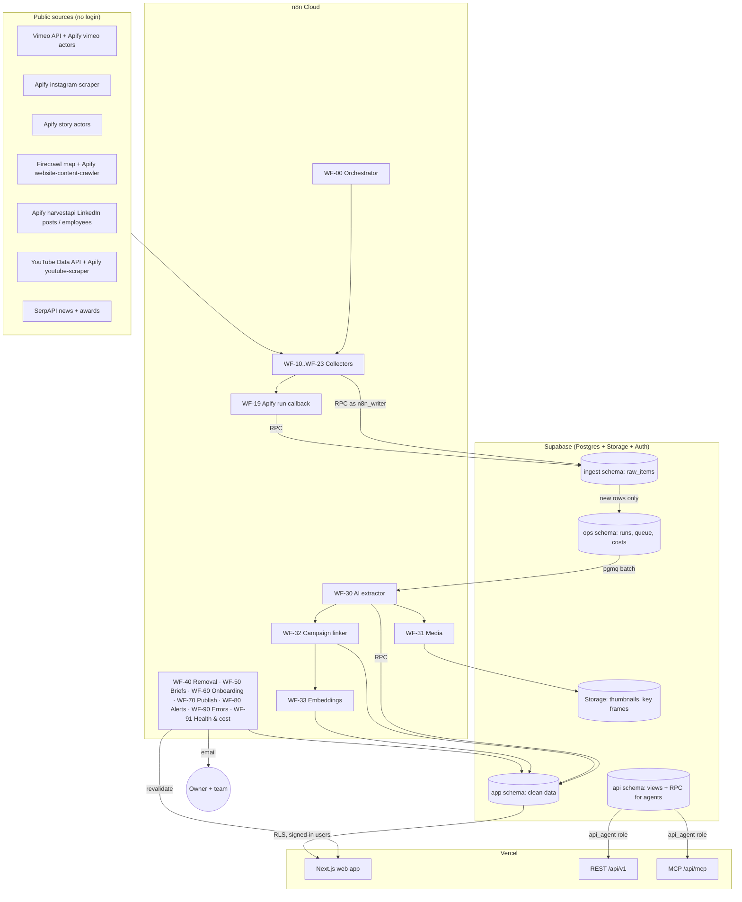

# Technical design — everyone. Market Radar

Version 1.0 · 17 Oct 2026. Binding decisions: `docs/DECISIONS.md`. Product scope: `docs/PRD.md`.
Companion specs: `docs/DATA_SCHEMA.md`, `docs/N8N_WORKFLOWS.md`, `docs/SCRAPING_SOURCES.md`, `docs/AI_PIPELINE.md`, `docs/API_SPEC.md`, `docs/ENVIRONMENT.md`, `docs/TESTING.md`, `DESIGN.md`.

> **Verify before you build.** Library versions, Supabase features, n8n nodes and actor inputs change. Before implementing anything from this document, check the current docs (Supabase changelog `https://supabase.com/changelog.md`, Next.js docs, n8n docs, the actor's Apify page) and record any deviation in the milestone PROGRESS.md and `docs/DECISIONS.md` → Changes.

---

## 1. Architecture



Principles:
1. **Supabase is the single source of truth.** n8n holds no state beyond execution logs; the web app holds no state beyond cache.
2. **Only new data costs money.** Watermarks per account, insert-only-if-new, and AI only on genuinely new rows.
3. **Small, replaceable parts.** One collector per source, one shared writer path, one AI worker. Each can be re-run alone.
4. **Least privilege.** `n8n_writer` can only execute ingest/ops RPCs. `api_agent` can only read the `api` schema and execute a few write RPCs. Browser users go through RLS.
5. **Everything is logged and costed.** `ops.scrape_runs`, `ops.ai_extractions`, `ops.cost_ledger`.

## 2. Repository layout (monorepo)

```
/                                  # GitHub: Everyone-Market-Researcher
├─ AGENTS.md                       # Codex operating rules (always read first)
├─ PROGRESS.md                     # Milestone board + "where we are now"
├─ DESIGN.md                       # UI design system + screen specs
├─ README.md
├─ docs/                           # PRD, technical, schema, API, workflows, plan …
├─ milestones/Mxx-*/               # MILESTONE.md (context + tasks) + PROGRESS.md (Codex notes)
├─ apps/
│  └─ web/                         # Next.js app (App Router) — UI, REST API, MCP
│     ├─ app/
│     │  ├─ (auth)/login/
│     │  ├─ (app)/…                # signed-in pages, see DESIGN.md §8
│     │  ├─ api/v1/…               # REST route handlers
│     │  ├─ api/mcp/[transport]/   # MCP server
│     │  ├─ api/revalidate/        # called by n8n WF-70
│     │  └─ auth/callback/         # Supabase OAuth callback
│     ├─ components/               # ui/ (primitives), features/ (feed, campaign, …)
│     ├─ lib/                      # supabase clients, db (api role), search, cache tags, auth
│     └─ styles/                   # tokens.css (from assets/brand/tokens.css), globals.css
├─ packages/
│  └─ shared/                      # zod schemas, TS types (generated DB types), taxonomy enums, utils
├─ supabase/
│  ├─ config.toml
│  ├─ migrations/                  # created with `supabase migration new` — never hand-named
│  ├─ seed.sql                     # taxonomies only; competitor seed runs via scripts/
│  └─ tests/                       # pgTAP tests (RLS, RPC contracts)
├─ n8n/
│  ├─ workflows/                   # exported JSON per workflow (WF-xx-name.json)
│  ├─ normalizers/                 # <actor>.js (pasted into Code nodes), _common.js, fixtures/, normalizers.test.ts
│  ├─ prompts/                     # versioned prompts (copied from reference/prompts at M07)
│  └─ README.md                    # how to import/export, credential names
├─ scripts/                        # seed import, handle resolution, eval harness, backfill planner
├─ data/                           # competitors.csv, competitor_accounts.csv, pilot_50.csv
├─ reference/                      # draft SQL, JSON schemas, prompts, payload contracts (inputs for Codex)
└─ assets/brand/                   # logotype, tokens
```

Package manager: **pnpm** workspaces. Node: **24 LTS** (pin in `.nvmrc` and `engines`). Pin exact versions and commit the lockfile.

## 3. Stack

| Layer | Choice | Notes |
|---|---|---|
| Database | Supabase Postgres 17 (Pro), extensions: `vector`, `pg_trgm`, `unaccent`, `pgmq`, `pg_cron`, `pg_net` (optional), `pgcrypto` | Separate dev/prod projects |
| Auth | Supabase Auth, Google provider | Invite-only membership enforced in DB (RLS) + app layout |
| Storage | Supabase Storage bucket `media` (thumbnails, key frames) | Public-read by unguessable path; writes only via n8n RPC-issued signed upload URLs or n8n Supabase credential limited to Storage (see §9) |
| Orchestration | n8n Cloud | Postgres node with `n8n_writer`; HTTP Request; verified Apify community node `@apify/n8n-nodes-apify` (or HTTP to Apify API); OpenAI via HTTP (Responses API) |
| Scraping | Apify actors (approved list), Vimeo API, YouTube Data API v3, Firecrawl, SerpAPI | `docs/SCRAPING_SOURCES.md` |
| AI | OpenAI: extraction model (fast, structured outputs, vision), reasoning model for briefs, `text-embedding-3-small` | Model IDs in env; chosen in M07 eval |
| Web | Next.js (latest stable, App Router, React Server Components), TypeScript strict | Pin exact version |
| UI | Tailwind CSS v4 + Radix primitives (shadcn/ui-style components restyled to `DESIGN.md`), TanStack Table, Recharts, lucide-react icons | No other UI kits |
| Validation | zod | Shared in `packages/shared` |
| DB access (web) | `@supabase/ssr` + `@supabase/supabase-js` for user-scoped reads; `postgres` (postgres.js) with the `api_agent` role for API/MCP | |
| MCP | `mcp-handler` (Vercel MCP adapter) + `@modelcontextprotocol/sdk` | Streamable HTTP |
| Email | Resend (default) or SMTP via n8n Email node | Decided in M13 (manual action) |
| Tests | Vitest (unit), Playwright (e2e), pgTAP via `supabase test db` (DB/RLS), contract tests for actor normalizers | `docs/TESTING.md` |
| CI | GitHub Actions: lint, typecheck, unit, DB tests (Supabase local), build | |
| Hosting | Vercel (prod + preview), Supabase (dev + prod), n8n Cloud (one instance, dev/prod separated by credentials + workflow tags) | |

## 4. Environments

| Env | Supabase | Vercel | n8n |
|---|---|---|---|
| local | `supabase start` (Docker) | `pnpm dev` | — (use dev n8n against dev Supabase) |
| dev | project `emr-dev` | Preview deployments | Workflows tagged `env:dev`, credentials `*-dev` |
| prod | project `emr-prod` | Production | Workflows tagged `env:prod`, credentials `*-prod` |

n8n Cloud has a single instance: keep **two copies** of every scheduled workflow (dev and prod) only when needed; default approach: workflows read `EMR_ENV` (`$vars.EMR_ENV` if the plan supports Variables, otherwise a CONFIG Set node at the top) and use the matching Postgres credential. Never point a dev workflow at prod. All variables and secrets: `docs/ENVIRONMENT.md`.

## 5. Data pipeline: only-new scraping

### 5.1 Due list
`ops.get_due_accounts(p_platform app.platform, p_limit int, p_run_id uuid, p_mode text)` returns accounts where `status in ('active','failing')`, `next_due_at <= now()`, not locked by a running job, ordered by priority tier then `next_due_at`. It **claims** them (sets `locked_until = now() + interval '2 hours'`, `last_run_id`) using `FOR UPDATE SKIP LOCKED` so parallel executions never double-process.

M01 schedules success at `now() + cadence - interval '4 hours'`, so a daily run at the same Cairo clock time finds the account due across DST changes. A daily cadence therefore becomes due in 20 hours; weekly cadence becomes due in 6 days 20 hours. Failures retry after 6 hours, including unfinished backfills. Successful unfinished backfills remain eligible for the next hourly backfill slot. M06 adds the stories cadence switch.

### 5.2 Watermarks
`app.competitor_accounts` stores:
- `last_item_published_at timestamptz` — newest item published time seen
- `last_external_id text` — newest item ID seen
- `backfill_status` (`pending` → `running` → `done` / `failed`), `backfill_from date default '2024-01-01'`

Collectors request only items after the watermark using, in order of preference: the source's date filter (e.g., Instagram `onlyPostsNewerThan`), API `since`/sort-by-date paging with stop-on-first-known-ID, or a small `resultsLimit` with stop-on-known-ID. Backfill uses `backfill_from` instead of the watermark, in pages.

### 5.3 Ingest RPC (single writer path)
`ingest.upsert_raw_items(p_run_id uuid, p_account_id uuid, p_items jsonb)`:
1. Inserts each normalized item into `ingest.raw_items` with `ON CONFLICT (platform, external_id) DO NOTHING`.
2. Computes a SHA-256 fingerprint from the lowercase caption, a separator, and thumbnail (or first media URL); if another item from the same competitor has the same hash within 30 days, links it as `duplicate_of` and does **not** enqueue AI. Empty caption/media has no fingerprint. A competitor row lock serializes canonical selection, including duplicates within one batch.
3. Upserts `app.items` (clean shell with source fields) for the new rows.
4. Sends new nonduplicate item IDs to both `ai_extract` and `media`.
5. Updates unlocked metrics for already-known items within the last 30 days without re-enqueueing. Source fields and human corrections stay intact.
6. Advances the account watermark monotonically by published time, breaking ties with the external ID in C collation; null/empty batches do not erase it. Returns `{inserted, duplicates, metrics_updated, new_item_ids[]}`.

M01 validates the whole normalized batch before writing and requires the current, unexpired account claim and matching running collection. Website root accounts map to the `website_work_page` collection. Repeated source keys within a batch use the last occurrence. `credits_text` and `media_urls` survive in `raw_items.normalized` and AI context. Account result receipts are first-write-wins: identical status/count/error retries do nothing, conflicting receipt fields fail, and later cursor arguments cannot overwrite the first receipt or release another run's lease.

All collectors map source payloads to the **normalized item contract** (`reference/n8n/normalized_item.schema.json`) before calling the RPC, so the database never sees actor-specific shapes except in `raw_items.payload`.

### 5.4 Metrics refresh
Daily collectors already return recent items; their metrics update in step 5 above. No extra calls just for metrics. Items older than 30 days are not refreshed.

### 5.5 Removal check (WF-40, weekly)
For each account, compare the IDs returned in the last 7 days of runs plus a light listing call against stored items from the last 90 days; items not seen → `status = 'removed'`, `removed_detected_at = now()`. Never delete.

### 5.6 Websites by diff (WF-21)
Daily: Firecrawl `map` of the work/portfolio URL (or the site root filtered by path patterns like `/work`, `/projects`, `/portfolio`) → compare with `app.website_pages` → only unseen URLs are crawled with `apify/website-content-crawler` (or Firecrawl `scrape` for one-offs). Backfill crawls all current work pages once.

### 5.7 Apify run pattern (long runs)
- **Every** Apify run (daily and backfill) starts asynchronously with an **ad-hoc webhook** (`ACTOR.RUN.SUCCEEDED`, `ACTOR.RUN.FAILED`, `ACTOR.RUN.TIMED_OUT`) pointing to WF-19 (`POST /webhook/emr-apify-callback`). WF-19 verifies the run by re-fetching it from the Apify API and matching `ops.apify_runs` (plus a secret header when n8n Variables are available), then ingests and closes the run. Collectors that start Apify runs therefore do not call Finish run themselves. WF-19 fetches dataset items in pages, normalizes and calls the ingest RPC. `ops.apify_runs` tracks run ID ↔ scrape run ↔ accounts.
- Every run's `usageTotalUsd` (from the Apify run object) is written to `ops.cost_ledger`.

## 6. n8n design

Full workflow specs: `docs/N8N_WORKFLOWS.md`. Conventions:
- **Naming:** `WF-XX · Name [env]`. Tags: `env:dev|prod`, `layer:collector|ai|ops`.
- **Shared sub-workflows** (called via Execute Workflow): `SUB · Start run`, `SUB · Finish run`, `SUB · Ingest items`, `SUB · Log cost`, `SUB · Normalize <platform>`, `SUB · Notify`.
- **Batching:** one execution handles a whole platform batch (loop over accounts in groups) to save executions. Target ≈ 160 executions/day for the pilot and ≈ 181 at full scale (≈ 4.8–5.4k/month of the 50k; `docs/N8N_WORKFLOWS.md` §3).
- **AI worker trigger:** collectors call WF-30 at the end of their run; a fallback schedule every 30 minutes drains anything left. No 5-minute polling.
- **Credentials:** `Supabase Postgres (n8n_writer) – dev/prod`, `Apify`, `OpenAI`, `SerpAPI`, `Firecrawl`, `Vimeo token`, `YouTube API key`, `Email`, `Revalidate secret`, `Supabase Storage` (see §9).
- **Error handling:** every workflow sets WF-90 as its error workflow; transient errors retry 3× with exponential backoff (node-level "Retry on fail"); an account with 3 consecutive failures is set `status = 'failing'` and appears in the daily health email.
- **Idempotency:** every write goes through RPCs that are idempotent on natural keys; re-running a workflow never duplicates.
- **Versioning:** after each change, export the workflow JSON to `n8n/workflows/` (no credentials in exports) and commit.

## 7. Supabase design

Full schema: `docs/DATA_SCHEMA.md` and draft SQL in `reference/sql/`.
- **Schemas:** `ingest` (raw, private), `app` (clean data; read by signed-in users under RLS), `ops` (runs, queue, costs, audit; private), `api` (security-invoker views + RPCs for agents), `private` (helper functions, `SECURITY DEFINER` only here, never exposed).
- **Exposed to the Data API:** `app` only (plus `api` is **not** exposed via PostgREST; agents reach it through the Next.js API with the `api_agent` Postgres role).
- **Roles:**
  - `authenticated` (signed-in users): `SELECT` on `app.*` where `private.is_member()`; analyst/admin writes only via RPCs (`app.review_*`, `app.admin_*`) that check role.
  - `n8n_writer` (LOGIN, `NOBYPASSRLS`): `USAGE` on `ingest`, `ops`; `EXECUTE` on `ingest.*` and `ops.*` RPCs only. No table grants.
  - `api_agent` (LOGIN, `NOBYPASSRLS`): `USAGE` on `api`; `SELECT` on `api.*` views; `EXECUTE` on `api.*` write RPCs (each checks the key scope passed via `set_config('app.api_scope', …, true)` within a transaction).
  - `service_role`/secret key: used only by `/api/internal/media-upload-url` (Storage signed upload URLs) and owner-run seed/admin scripts; never in n8n, never in the browser, never in any other route (including `/api/v1` and MCP).
- **RLS:** enabled on every table in every schema. Policies use `TO authenticated` + `private.is_member()` (or `private.has_role('analyst')`). Views use `WITH (security_invoker = true)`.
- **Connection:** n8n and the API connect through the **Supavisor pooler** (IPv4). n8n: session mode (port 5432). Vercel API: transaction mode (port 6543) with prepared statements disabled.
- **Queue:** `pgmq` queues `ai_extract`, `embed`, `media`. RPC `ops.claim_queue_batch(queue, n, vt_seconds)` reads with a visibility timeout; `ops.ack_queue(queue, msg_ids)` archives.
- **Cron (`pg_cron`):** housekeeping only (unlock stale account locks, archive queue messages > 30 days, refresh materialized stats). Scraping schedules live in n8n.
- **Search:** `tsvector` (config `simple` + `unaccent`, weighted title/brand/caption) + `pg_trgm` for names + `pgvector` HNSW (`vector_cosine_ops`) on embeddings; hybrid ranking via reciprocal rank fusion in `app.search(...)` (callable by `authenticated` and `api_agent`).
- **Types:** generate TypeScript types with `supabase gen types typescript` into `packages/shared/src/db.types.ts` after every migration.

## 8. AI layer

Full spec: `docs/AI_PIPELINE.md`. Summary:
- WF-30 claims a batch (default 20) from `ai_extract`, builds the prompt (`reference/prompts/extract_item.v1.md`) with item text, account context, competitor context, known aliases for brands mentioned, and optionally a thumbnail (vision only if `needs_vision`).
- Calls OpenAI with **strict structured outputs** (`reference/json-schemas/item_extraction.v1.json`).
- `ops.apply_extraction(item_id, result jsonb, meta jsonb)` (SECURITY DEFINER in the non-exposed `ops` schema, executed by `n8n_writer`) resolves entities (aliases exact → trigram ≥ 0.6 → embedding ≥ 0.85), writes extraction, sets `ai_status = published | review`, inserts review tasks, logs tokens/cost.
- WF-32 links campaigns daily; WF-33 embeds new/changed items, campaigns, competitors and briefs; WF-50 writes briefs.
- Human corrections set `locked_by_human = true` on the field set; later runs never overwrite locked fields.

## 9. Media (thumbnails and key frames)

- Path: `media/{competitor_slug}/{platform}/{external_id}/thumb.jpg` (+ `frame-01.jpg` … max 3).
- WF-31 downloads the source thumbnail URL (Instagram/Vimeo/YouTube CDN), resizes if > 1280 px wide (n8n "Edit Image" node), uploads to Storage, writes `app.media_assets` via RPC.
- Upload auth: n8n uses a **Storage-only** credential: an RPC `ops.create_media_upload_url(path)` (SECURITY DEFINER in `private`, executed by `n8n_writer`) is **not** possible for Storage signed upload URLs from SQL, so use this approach: a tiny Next.js route `POST /api/internal/media-upload-url` protected by `INTERNAL_WEBHOOK_SECRET` returns a signed upload URL created server-side with the secret key **scoped to that route only**. This is the single place the secret key is used at runtime; document it in `docs/ENVIRONMENT.md` and audit it. (Alternative if the owner prefers: S3-compatible access keys for the Storage bucket only.)
- Key frames: only for Vimeo/YouTube when available as thumbnail variants (no video download, D-19).

## 10. Web app

- **Rendering:** React Server Components for pages; client components only for interactive pieces (filters, tables, search box, review actions).
- **Data access:** server-side Supabase client from `@supabase/ssr` with the user's session → RLS-scoped reads of `app` views. No direct table access from the browser except via typed server actions/route handlers.
- **Caching:** `fetch`/data functions tagged with cache tags: `feed`, `competitor:{slug}`, `campaign:{id}`, `brand:{slug}`, `agency:{slug}`, `person:{slug}`, `brief:{week}`, `stats`. `POST /api/revalidate` (header `x-emr-secret` = `INTERNAL_WEBHOOK_SECRET`) receives `{tags: string[]}` from WF-70 and calls `revalidateTag`. Pages use `revalidate = 3600` as a fallback. Use the current Next.js caching API (verify: `use cache`/`cacheTag` vs `unstable_cache`) and document the choice.
- **Auth flow:** `/login` → Google OAuth → `/auth/callback` → middleware/layout calls RPC `app.me()`; no active membership → `/no-access` (invite-only, see T-11). A trigger on `auth.users` creates the membership from `app.member_invites`.
- **i18n:** strings in `apps/web/messages/en.json` via `next-intl` (Arabic file added later); content blocks use `dir="auto"` and the Arabic font stack.
- **Accessibility:** Radix primitives, visible focus rings, keyboard shortcuts in review (`J/K` next/prev, `A` approve, `E` edit, `R` reject).
- **Charts:** Recharts with the palette in `DESIGN.md` §3.4.
- **Images:** `next/image` with Supabase Storage as a remote pattern; thumbnails lazy-loaded; `sizes` set per grid.

## 11. REST API and MCP

Full spec: `docs/API_SPEC.md`.
- Route handlers under `/api/v1/*`; MCP at `/api/mcp` (Streamable HTTP).
- Auth: `Authorization: Bearer emr_<prefix>_<secret>`; lookup by prefix, verify `sha256(secret + pepper)`; scope check; rate limit (per key, e.g., 120 req/min) via a DB counter table or Upstash if added later; every call logged in `ops.api_calls`.
- Queries run through postgres.js as `api_agent` inside a transaction that sets `app.api_key_id` and `app.api_scope` for auditing and RPC checks.

## 12. Security checklist (apply in every milestone)

- RLS enabled on every new table; policies written for the real access model; pgTAP test proves a non-member gets zero rows.
- Views: `WITH (security_invoker = true)`.
- `SECURITY DEFINER` only in **non-exposed** schemas (`private`, `ingest`, `ops`, `api`), with `SET search_path = ''`, fully-qualified names, an explicit role/scope check where users or agents can reach it, `REVOKE EXECUTE … FROM PUBLIC`, and `GRANT EXECUTE` only to the one role that needs it (`n8n_writer`, `api_agent` or `authenticated`). Functions in the exposed `app` schema are `SECURITY INVOKER`.
- Never use `user_metadata` for authorization; roles live in `app.members.role`.
- No secret in any `NEXT_PUBLIC_*` variable. The browser gets only the Supabase URL and publishable key.
- Webhooks (revalidate, Apify callback, media upload URL) require a secret header and are rejected otherwise; compare in constant time.
- Scoped Supabase personal access token for CLI/MCP; never commit tokens; `.env*` git-ignored.
- Run `supabase db advisors` (or MCP `get_advisors`) before every migration commit; fix all security findings.
- Pin dependencies; commit lockfiles; enable Dependabot.
- Public data only (D-24): no cookies, no logins, no CAPTCHA solving in any actor input.

## 13. Observability and cost

- `ops.scrape_runs`: one row per workflow run × platform (+ per-account rows in `ops.scrape_run_accounts`).
- `ops.cost_ledger`: provider, unit, quantity, `cost_usd`, run/item reference, `day`. Sources: Apify run `usageTotalUsd`; OpenAI `usage` × price table `ops.price_book`; SerpAPI searches × plan price; Firecrawl credits × price; fixed monthly fees (n8n, Supabase, Vercel) as daily accruals by WF-91.
- `app.costs_summary(p_from, p_to)` (admin RPC, private worker over `ops.cost_ledger`) powers the Costs page: per day/month/provider/platform/competitor, cost per new item, month forecast (`spend_to_date / days_elapsed × days_in_month`, refined with fixed fees).
- WF-91 daily health email: failing accounts, queue depth, items new per platform, cost yesterday vs. budget.

## 14. Performance

- Indexes: every FK; `(competitor_id, published_at desc)`, `(platform, published_at desc)`, `(ai_status, created_at)`; partial index on `status = 'active'`; GIN on `search_tsv`; GIN trigram on names/aliases; HNSW on embeddings.
- Pagination: keyset (`published_at, id`) for feeds; never `OFFSET` on large lists.
- Batch inserts in RPCs via `jsonb_to_recordset`; one transaction per batch; keep transactions short.
- Materialized stats (`app.stats_daily`) refreshed by WF-91 or `pg_cron` for dashboards.

## 15. Deployment and CI/CD

- **GitHub Actions** on PR: install, lint (ESLint + Prettier check), typecheck, unit tests, DB tests (`supabase start` + `supabase db reset` + `supabase test db`), Next build.
- **Vercel**: Git integration; preview per PR (points at dev Supabase); production from `main`.
- **Supabase migrations**: applied to dev by `supabase db push` (Codex, after review), to prod by the owner or CI job with approval (`workflow_dispatch` + environment protection).
- **n8n**: changes made in dev workflows → tested → exported → prod copy updated via MCP/API → exported.

## 16. Coding conventions

- TypeScript strict; no `any`; zod at every boundary (API input, webhook payloads, AI output re-validation).
- SQL: lowercase identifiers, `snake_case`, `bigint generated always as identity` or `uuid` (`gen_random_uuid()`) PKs as specified in DATA_SCHEMA, `timestamptz` everywhere, `text` over `varchar`, check constraints for enums that may change (or Postgres enums for stable ones as specified).
- Commits: Conventional Commits (`feat(web): …`, `fix(db): …`), small and focused, one milestone task per commit where possible.
- Branches: `m{NN}-{slug}` per milestone; PR per milestone (or per large task) into `main`.
- Never commit secrets, `.env`, or n8n exports containing credentials.
